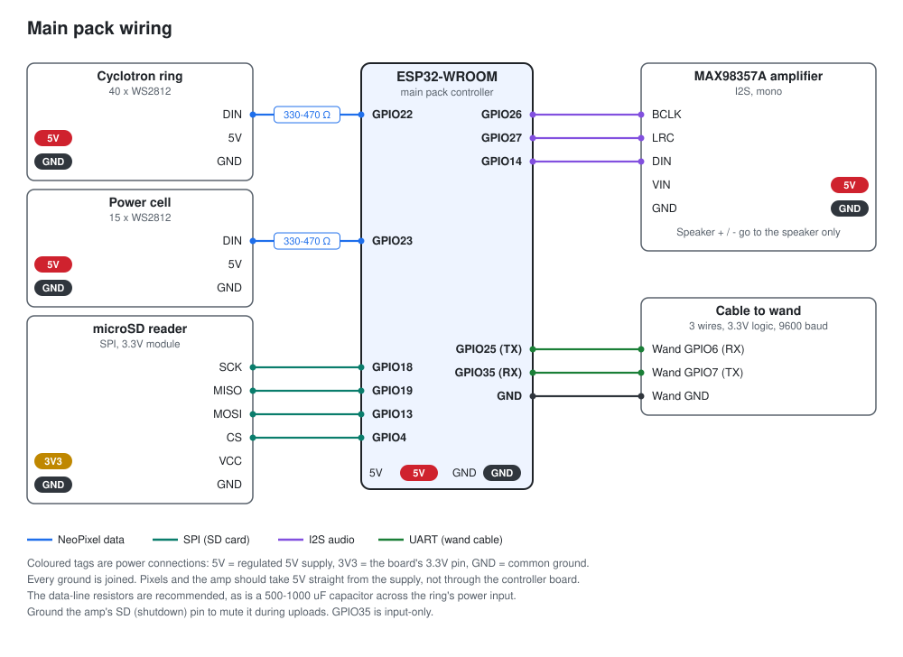
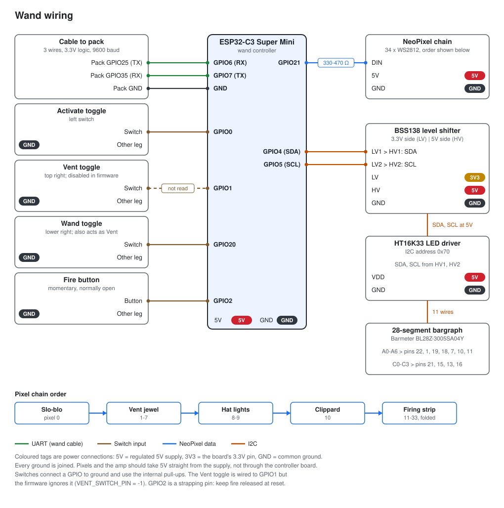
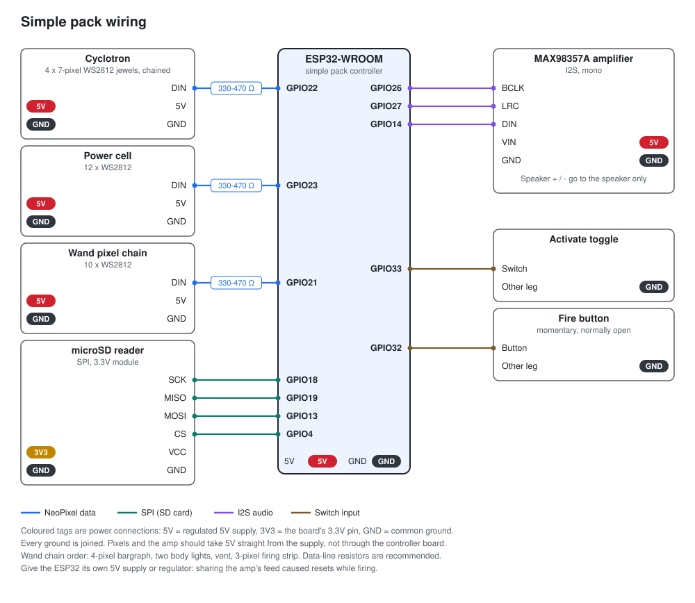

<!--
DRAFT. Written through Problem 2; the rest is still notes to write from.
Everything stated as fact comes from the proton-pack-2026 repo. TODO comments
mark things only you know. The title and permalink are placeholders.

Angle: how I solve problems, and how I actually use AI to do it.
-->

## The hook

<!-- TODO: video of power-up, firing, overheat and vent goes here, above everything. -->

I built a proton pack. It lights up, it hums, it fires, and if you hold the trigger for eight seconds it overheats and vents with a hiss of steam. There's a wand with a 28-segment bargraph, four film-accurate sound themes, and a web page on my phone to control the whole thing.

<!-- TODO: one or two sentences on why. Halloween? A long-standing itch? -->

It runs on two ESP32 microcontrollers and about 7,400 lines of C++, and most of that code was written with an AI assistant that had never seen the hardware and never would.

That last part is what this post is really about. The build was fun, but the interesting bit was the debugging: a pack that rebooted every time I fired it, audio that ticked for no obvious reason, a display that swore it was working and stayed dark. Here's how each of those got solved, where AI helped, and where it didn't.

## What I set out to build, and the constraint I picked

If you want a screen-accurate proton pack, the reference is [GPStar](https://github.com/GPStarTechnologies/GPStar-Core-Source). Their kit is excellent, and their firmware is open source. It also assumes their own controller boards and a separate audio board to play the sounds.

I wanted the same behaviour on parts from my own drawer: a plain ESP32 dev board in the pack, an ESP32-C3 Super Mini in the wand, and three wires between them. No dedicated audio board. The ESP32 would read WAV files off an SD card and mix them itself.

That one decision caused most of the problems in this post. I'd make it again.

The starting point was [GBPack32](https://github.com/swbradshaw/GBPack32), and the first commit on September 11 was a single red light chasing around a ring. Six weeks later there were three firmware builds: the main pack, the wand, and a second, simpler pack.

<!-- TODO: shell, speaker, battery, rough cost. A parts photo would sit well here. -->

Here's what's inside the pack:

And the wand:

## How I worked with AI

Of the 23 commits in the original history, 18 were co-authored with **GitHub Copilot**. So this was a pairing exercise from start to finish, and it took a while to find a way of working that held up.

The problem with AI and hardware is simple: the assistant can't see anything. It can't hear the speaker crackle or watch a display stay dark. It will happily write firmware for a board it's imagining. I was its eyes and its test bench. It proposed, I flashed and watched, and what I saw went back in.

The thing that made that loop work was a notes file. The repo has a 275-line instructions file that the assistant reads every time: the pin map, every decision we'd made, dated notes from each bring-up session, and a few hard rules. Two of those rules earned their place:

- **Check GPStar's source before adding behaviour.** Otherwise the assistant invents plausible timings that are wrong.
- **Check the board's MAC address before uploading.** More on that one later.

<!-- TODO: the moment the AI was confidently wrong, and how you caught it. This section needs it. -->

<!-- TODO: what you kept for yourself. Architecture? Bench debugging? Final review? -->

When it came time to open-source the project I used **Claude** for the release chores: an audit of the full git history for secrets and personal details, picking a licence that was compatible with the libraries I'd used, and a README rewrite. That audit turned up a dozen places where my README no longer matched the code. The docs had drifted while the firmware moved on, and I hadn't noticed. AI as a reviewer turned out to be at least as useful as AI as an author.

## Problem 1: the pack reset every time I fired

The first time everything was wired together, holding the fire button rebooted the pack. Not sometimes. Every time.

A reboot can be a lot of things: a crash, a watchdog, a bad pointer. Guessing would have been slow, so the first step was making the failure say what it was. The ESP32 records why it last restarted, and I surfaced that on the control page. The answer was *brownout*. The chip wasn't crashing. It was losing power.

That narrowed it right down. The ESP32 was sharing the amplifier's 5V battery feed. Firing is the loudest thing the pack does, and loud audio plus a Wi-Fi transmit burst was enough to drag the supply below what the chip could tolerate.

The fix came in layers:

1. **At the source:** give the ESP32 its own 5V supply, and run the amp and LEDs on separate, thicker wires from the battery.
2. **Reduce the load:** a lower default volume and a dimmer bargraph on the simple pack.
3. **Recover anyway:** after a brownout the SD card could be left stuck, which meant no sound until a power cycle. The firmware now releases the card and remounts it on boot.

That third one is the habit I'd point to. Fixing the cause is the job, but batteries sag and connectors work loose, so the pack should also come back cleanly when it happens again.

## Problem 2: ticks and static in the audio

The mixer plays up to eight WAV files at once: the pack hum, the wand hum, a beep loop, the firing stream, a tail when you release. And every so often, it ticked.

"Sometimes it sounds bad" is not something you can debug, so again the first move was instrumentation. The firmware counts three things every second and prints them: buffer underruns, clipped samples, and how hard the limiter is working. With numbers on screen, one vague complaint split into three separate problems.

**Slow file opens.** Underruns spiked whenever a new sound started. Every file open scans the SD card's root directory, and my card had twice as many files as I thought. macOS quietly writes a hidden `._` file next to each one you copy. Cleaning those off with `dot_clean` made opens fast again.

**Too many sounds starting at once.** Flipping a switch can start three or four sounds in the same instant, and opening them all together starved the buffers. Two changes fixed it: SD reads moved to their own task so the audio output never waits on the card, and that task opens only one new file per pass.

**A fizz that wasn't a bug.** Two of the themes had a faint fizz under the hum, and the counters said everything was clean. No underruns, no clipping. It turned out to be in the recordings. Most of the energy in those hums sits around 69 Hz, which my small speaker can't reproduce, so all that was left was the low-level grit on top.

That last one was the most useful result of the three. The counters let me stop chasing a bug that didn't exist.

## Problem 3: hardware that lied

> **Notes**
> - Bargraph: the driver answered on I2C but the display stayed dark. A tiny scanner firmware proved the driver was alive; the missing piece was 5V on the driver and the level shifter's high side.
> - Amp: a separate bare-bones audio test firmware (no SD, no wand link, no animations) separated amplifier and power problems from firmware ones.
> - Vent switch: stopped responding after the shell was fitted. Rather than reopen the shell, the firmware now lets one switch do both jobs, and the three-flip Bluetooth gesture moved with it.
> - The method across all three: build the smallest firmware that tests one thing. The repo keeps three of these as permanent build targets.

## Problem 4: not enough memory for everything

> **Notes**
> - The Bluetooth stack and the SD mixer do not both fit in RAM on an ESP32-WROOM.
> - Solution: Bluetooth speaker mode is a reboot into a different personality. Wi-Fi, the web page and pack sounds are off; lights and the wand link stay on. Any power cycle returns to normal mode.
> - It also needed a different partition table to fit two firmware slots for updates over Wi-Fi.
> - Roughly 30-40 KB of heap is free with Wi-Fi running; the boot log prints it after each stage.

## Designing for things going wrong

> **Notes**
> - Wand-to-pack link: 8-byte packets with a CRC, sent as absolute state rather than events, so a lost packet cannot leave the pack stuck firing. No valid packet for 500 ms shuts the pack down.
> - Fire only triggers on a fresh press, so a button held through start-up or cooldown does nothing.
> - The simple pack's upload checks the board's MAC address, and its Wi-Fi uses a different subnet, so its firmware cannot be flashed onto the main pack by mistake. Added after a board swap mid-project.
> - Lights run on timers matched to the sounds but never wait for audio or need the SD card.
> - This is the section that ties the hobby project to how you work day to day: explicit failure modes, safe defaults, observability before fixes. TODO: say that in your own words.

## The second pack

> **Notes**
> - One board, one switch, one button, fewer pixels. Same controller, sounds and themes, reused unchanged.
> - TODO: who it is for and what they thought of it. The human ending of the post.

## What I'd tell someone doing this with AI

> **Notes**
> - Candidates, pick the ones you believe: keep a notes file the assistant reads every time; make it check a reference implementation before inventing; instrument before you ask it to fix; treat docs as something to audit, because they drift (the README did); let it do release chores.
> - TODO: what you would do differently.

## Try it

> **Notes**
> - Repo: https://github.com/ptasker/proton-pack-2026 (make it public before this goes live).
> - GPL-3.0-or-later. No sound files included.
> - Credits: GPStar Core Source, GBPack32.
